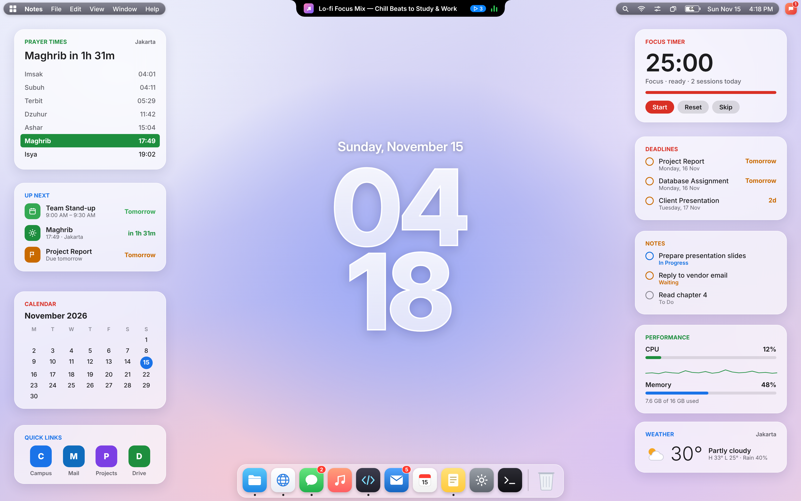

# Dynamic Island for Windows

A macOS-inspired desktop shell for Windows 10/11, written in C# / WPF (.NET 8).
It adds a menu bar, a Dynamic Island–style notch, a Dock that replaces the Windows taskbar,
and glass desktop widgets.



> The screenshot uses demo data. Not affiliated with or endorsed by Apple or Microsoft.

## Features

### Menu bar (top)
- Glass capsules: system menu, active app name and its menus (File, Edit, View, Window, Help).
  Classic Win32 apps show their real menus; other apps get a generic menu that sends standard shortcuts.
- **Search** (Spotlight-style): apps, Settings pages, web and Windows Search.
  Right-click an app result for *Run as administrator*, *Open file location*, *Add to Dock* and *Copy path*.
- Wi-Fi (network list with password dialog), Control Center (Wi-Fi, Bluetooth, brightness, volume,
  Now Playing, battery), Show Desktop toggle, microphone/camera indicators, battery with the
  percentage inside the icon, clock → Notification Center (latest notifications, Clear All, Up Next).
- System menu: About, Settings, Store, All Apps, Recent Items, Force Quit, Sleep, Restart, Shut Down,
  Lock, Log Out, show/hide desktop widgets, *Apply macOS Look*.

### Dynamic Island (notch)
- Compact black notch with concave "ears" that blend into the top edge of the screen;
  shows the playing song with an equalizer and short notifications.
- Hover to expand (dark glass) with tabs:
  - **Notes** – notes with To Do / In Progress / Waiting / Done status, edit, due dates
    (date picker or quick syntax such as `Report @25/11`, `@today`, `@tomorrow`, `@fri`, `@none`).
  - **Calendar** – month view + agenda from Google Calendar secret iCal addresses.
- ⚙ menu: Open at Login, Restart, Quit.

### Dock (bottom)
- Replaces the Windows taskbar (the taskbar is hidden while the app runs and restored on exit).
- Magnification, auto-hide, drag to reorder, running dots, Recycle Bin, open apps not pinned.
- Notification badges read from the Windows notification database and unread counts in window titles.
- Optional **Minimal Icons** (rounded gradient tiles with simple symbols), toggle from the Dock's context menu.

### Desktop widgets
- Big glass clock in the center (stacked hours and minutes).
- Left column: **Prayer Times** (calculated offline), **Up Next**, **Calendar**, **Quick Links**.
- Right column: **Focus Timer** (Pomodoro 25/5, long break every 4 sessions), **Deadlines**,
  **Notes**, **Performance** (CPU & memory), **Weather** (Open-Meteo, no API key).
- Drag cards by their title, resize from the bottom-right grip, Ctrl + scroll to zoom,
  double-click the grip to reset. Quick Links: right-click → *Edit links…*.

### macOS Look (optional)
System menu → *Apply macOS Look (Light/Dark)* changes Windows' own settings (light/dark mode,
transparency, blue accent, neutral title bars, an original abstract wallpaper, hidden desktop icons).
Previous values are backed up and *Restore Windows Look* puts everything back.

### Performance
- Everything hides and pauses while a fullscreen app (video, game, presentation) is running.
- Power-saving mode on Battery Saver or battery ≤ 20%: fewer updates, no heavy effects;
  Windows efficiency mode (EcoQoS) on battery.
- Desktop widgets skip redraws while the desktop is covered by a maximized window.

## Requirements
- Windows 10 (19041+) or Windows 11
- [.NET 8 SDK](https://dotnet.microsoft.com/download/dotnet/8.0)

## Build & run
```
git clone https://github.com/<your-account>/DynamicIsland.git
cd DynamicIsland
dotnet build
dotnet run
```
Or double-click **Run Dynamic Island.cmd**: it closes a running instance, rebuilds, starts the app,
and creates a *Dynamic Island* shortcut on your Desktop the first time.

Only one instance runs at a time. Quit from the notch's ⚙ menu; the Windows taskbar comes back on exit.

## Configuration & data
Everything is stored locally for the current user:

| What | Where |
|---|---|
| Notes | `%AppData%\DynamicIsland\notes.json` |
| Dock apps | `%AppData%\DynamicIsland\dock.json` |
| Widget layout | `%AppData%\DynamicIsland\widgets-v2.json` |
| Quick Links | `%AppData%\DynamicIsland\quicklinks.json` |
| Calendar iCal addresses | `%AppData%\DynamicIsland\calendars.json` |
| Prayer times location | `%AppData%\DynamicIsland\prayer.json` |
| Theme backup | `%AppData%\DynamicIsland\theme-backup.json` |
| Other settings | `HKCU\Software\DynamicIsland` |

**Google Calendar:** open the notch's Calendar tab → *Connect Google Calendar* button, and paste the *Secret address in iCal format*
from Google Calendar → Settings → your calendar → *Integrate calendar*. Treat that address like a password.

**Privacy:** there is no telemetry. Network requests are only made to your calendar's iCal address,
Open-Meteo (approximate coordinates of the selected location, for weather) and the links you open.

## Notes & limitations
- Windows has no public API for some features (Focus/Do Not Disturb state, the tray overflow);
  those use best-effort techniques and may change with Windows updates.
- Background (tray) apps: press **Win + B**, then **Enter**.
- If the app crashes, details are written to `crash.log` next to the project/executable,
  and the taskbar is restored.

## License
MIT – see [LICENSE](LICENSE).
